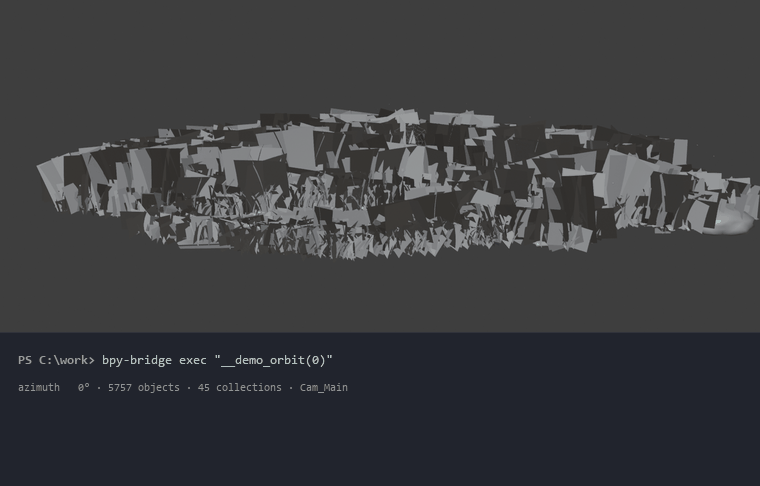
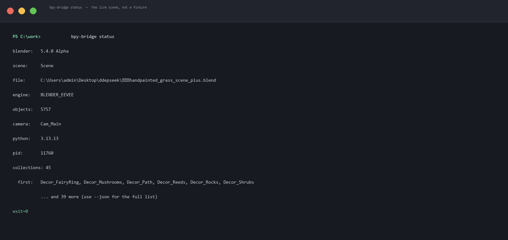
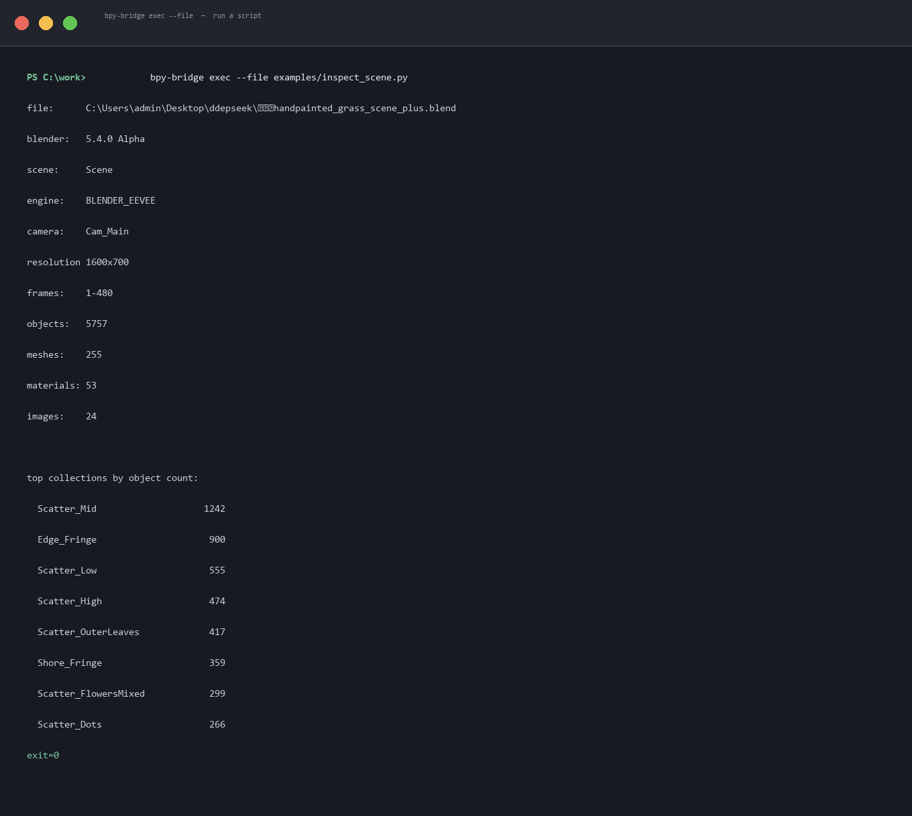
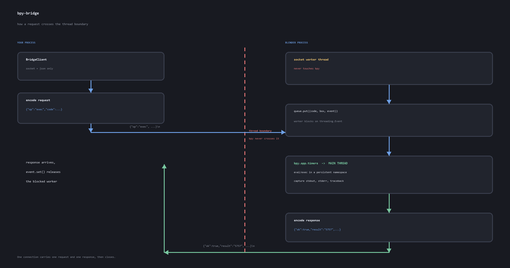

# bpy-bridge

**English** | [简体中文](README.zh-CN.md)

**Drive a running Blender from any process — one line of code, real stdout, real tracebacks.**

[](https://github.com/Leechuihui/bpy-bridge/actions/workflows/tests.yml)
[](https://www.python.org/downloads/)
[](https://www.blender.org/)
[](#why-zero-dependencies)
[](LICENSE)

---

## The problem

Blender's Python API has one hard rule: **`bpy` is not thread safe, and it only works on the main thread.** That single constraint makes "automate Blender from outside" surprisingly painful:

| What you want | What usually happens |
|---|---|
| Poke at a scene from a notebook | You can't. `bpy` isn't importable outside Blender. |
| Run a script and watch the viewport update | `blender --background` renders, but you see nothing. |
| Let an AI agent inspect what it just built | The agent has no channel into the running session. |
| Iterate on a procedural asset 40 times | You relaunch Blender 40 times. |

People work around this with `bpy.ops` hacks, `--python-expr` relaunches, or a full-blown RPC framework. `bpy-bridge` is the small version that actually holds up:

- **~600 lines**, standard library only, no dependencies in either half.
- **Thread-correct by construction.** Socket threads never touch `bpy`; a `bpy.app.timers` callback runs queued code on the main thread.
- **Real results.** You get `stdout`, the return value, the full traceback, and a duration — not just "OK".
- **Safe by default.** Loopback-only bind, random 256-bit token, constant-time comparison, refuses to expose itself to the network unless you insist.
- **Tested without Blender.** A fake `bpy` makes the whole thing testable in CI.

## See it running

Every screenshot below was generated by running the actual command against a live
Blender session — a production scene with **5,757 objects across 45 collections**,
not a three-cube demo. They are build artifacts, regenerated by
`tools/render_terminal.py`, so they cannot drift from what the code does.

Here a shell script orbits the camera of a scene that is open in a live Blender,
one `exec` per frame, capturing the real viewport each time:



That is `bpy-bridge exec` driving `Cam_Main` while Blender stays interactive —
no relaunch, no headless mode, no lost undo history. The terminal strip under each
frame shows the exact command that produced it.

Ask a running Blender what it has open, from a plain terminal:

```bash
bpy-bridge status
```



Run a script and get its real output back:

```bash
bpy-bridge exec --file examples/inspect_scene.py
```



And the feature that changes how a session feels — the viewport captures itself:

```bash
bpy-bridge shot viewport.png
```


**[→ Full tutorial with 8 walkthrough steps](docs/tutorial.md)** ·
**[→ Configuration reference](docs/configuration.md)**

## Quickstart

### 1. Start the bridge inside Blender

Open Blender, press `Shift+F4` for the Python console, and run:

```python
exec(compile(open(r"/path/to/bpy_bridge/server.py", encoding="utf-8").read(),
             "bpy_bridge_server", "exec"))
```

You'll see:

```
[bpy-bridge] listening on 127.0.0.1:9876 (protocol v1)
[bpy-bridge] token file: /home/you/.bpy-bridge/token
```

> Want it on every launch? Drop the same `exec(...)` into a file under
> `scripts/startup/` in your Blender config directory. See [docs/install.md](docs/install.md).

### 2. Talk to it from anywhere

```bash
pip install bpy-bridge

bpy-bridge ping
# pong  127.0.0.1:9876

bpy-bridge status
# blender:   4.2.0
# scene:     Scene
# engine:    BLENDER_EEVEE_NEXT
# objects:   1886
# camera:    Camera

bpy-bridge exec 'len(bpy.data.objects)'
# 1886

bpy-bridge exec --file build_scene.py --timeout 900
```

Or from Python:

```python
from bpy_bridge import BridgeClient

bridge = BridgeClient()
print(bridge.exec("bpy.context.scene.name").result)

result = bridge.exec("1 / 0")
print(result.ok)          # False
print(result.kind)        # 'exec'
print(result.error)       # full traceback, rendered inside Blender
```

That's the whole idea. Everything else is polish.

## What it looks like in practice

**Iterating on a procedural scene without relaunching Blender:**

```python
from bpy_bridge import BridgeClient

bridge = BridgeClient()
for seed in range(40):
    bridge.exec_or_raise(f"import random; random.seed({seed}); bridge.exec_file('scatter.py')")
    bridge.screenshot(f"frames/seed_{seed:02d}.png")
```

**Letting an agent check its own work:**

```python
result = bridge.exec("bridge.status()")
if json.loads(result.result)["objects"] < 100:
    raise RuntimeError("the scatter did not run")
```

**Driving Blender from CI** (where it's already open on a build machine):

```yaml
- run: bpy-bridge exec --file tools/export_gltf.py --timeout 1800 --json
```

The `--json` flag emits exactly one JSON object on stdout, with stable exit codes, so a shell script or an LLM tool-call layer can consume it without parsing prose.

## Exit codes

The CLI's exit codes are part of the contract:

| Code | Meaning |
|---|---|
| `0` | Success |
| `1` | Code ran inside Blender and raised |
| `2` | Usage error (bad flags, unreadable `--file`) |
| `3` | Cannot reach Blender (not running, wrong port, connection dropped) |
| `4` | Token rejected |
| `5` | Timed out |

`--json` failures also carry `"exit": <code>`, so a caller never has to branch on stderr text.

## Security model

This tool executes arbitrary Python with your user's privileges. That is the point — but it means the defaults matter.

| Control | Behaviour |
|---|---|
| **Bind address** | `127.0.0.1` only. `BridgeServer(host="0.0.0.0")` raises `ValueError` unless you pass `allow_remote=True`. |
| **Authentication** | Random 256-bit token via `secrets.token_urlsafe(32)`, persisted to `~/.bpy-bridge/token` with `0600` on POSIX. |
| **Comparison** | `secrets.compare_digest`, byte-encoded so a non-ASCII token can't crash the auth path. |
| **Frame size** | Requests and responses capped at 4 MiB so a runaway `print()` loop can't wedge the socket. |
| **Timeouts** | Every request has a budget; a stuck job reports `kind: timeout` instead of hanging the client forever. |

What it deliberately does **not** do: sandbox the code, restrict which modules you can import, or protect you from yourself. If an attacker can already reach your loopback token file, they own the account regardless.

Read [docs/security.md](docs/security.md) before putting this anywhere unusual.

## Why zero dependencies

The server half runs inside Blender's bundled Python interpreter, which frequently has no `pip` and no network access. A single dependency there means "this doesn't work" for a large fraction of users. So the server is one file you can copy, `exec()`, and forget.

The client half uses only `socket` and `json` for the same reason: it should work in a bare venv, in a container, and on a phone.

## How it works



The whole design exists to respect one constraint: **`bpy` is main-thread only.**
So the socket worker thread never touches it. It encodes the work, drops it in a
queue, and blocks on a `threading.Event`. A `bpy.app.timers` callback drains that
queue on Blender's main thread, runs the code there, captures `stdout` and the
traceback, and signals the waiting worker. Nothing crosses the boundary in the
wrong direction.

One connection carries one request and one response, then closes — which sounds
wasteful and is in fact the reason there are no framing bugs.

`docs/protocol.md` documents the wire format precisely enough to write a client in another language.

## Installation

```bash
pip install bpy-bridge
```

Requires Python 3.8+ on the client side. Blender 3.2+ on the server side (`temp_override` is used when available, with a fallback for older builds).

The server file is also usable **without installing anything**:

```bash
curl -O https://raw.githubusercontent.com/Leechuihui/bpy-bridge/main/bpy_bridge/server.py
```

and `exec()` it as shown above. It has no imports outside the standard library.

## Development

```bash
pip install -e ".[dev]"
pytest -q                        # 127 tests, no Blender required
python tests/e2e_smoke.py        # 8 checks across two real processes
python tests/check_readme_links.py  # language switcher + relative links
```

The test suite carries a fake `bpy` (`tests/fake_bpy.py`) that mimics the slice of the API the bridge touches, plus a background "pump" thread that plays the role of Blender's main thread. That means CI can verify the threading model without ever launching Blender.

## Status

Early but functional. The protocol is at version 1 and the wire format is documented; breaking it would require a major version bump. Contributions welcome — see [CONTRIBUTING.md](CONTRIBUTING.md).

Known limitations, stated plainly:

- **No cancellation.** Once code is running on Blender's main thread, there is no safe way to interrupt a Python frame. A timed-out request leaves the job running.
- **One request at a time per connection.** Concurrency comes from multiple connections, not from multiplexing.
- **No Windows service mode.** The bridge lives as long as Blender does.
- **`shot()` needs a GUI.** Headless Blender has no window to screenshot.

## Star history

[](https://star-history.com/#Leechuihui/bpy-bridge&Date)

## License

MIT — see [LICENSE](LICENSE).
