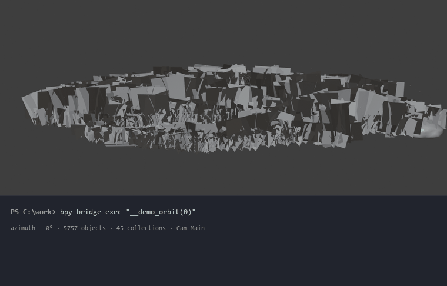
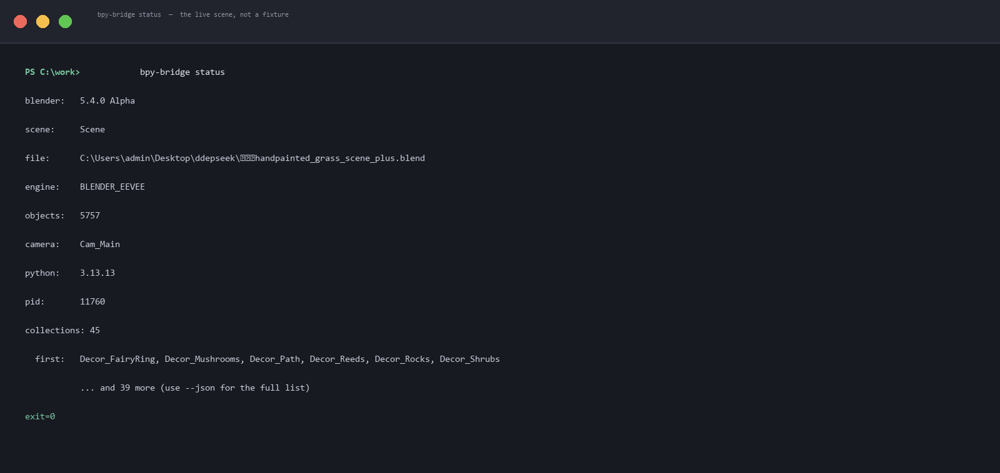
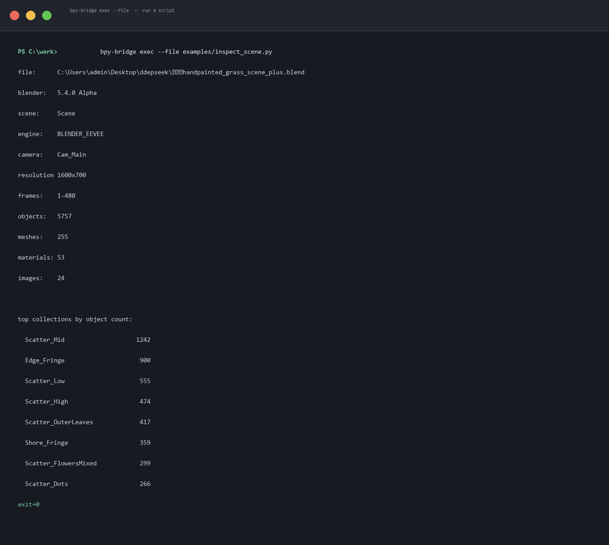
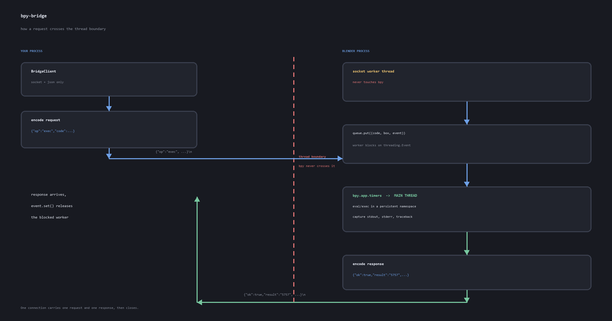

# bpy-bridge

[English](README.md) | **简体中文**

**从任意进程驱动正在运行的 Blender —— 一行代码，拿到真实 stdout 和真实 traceback。**

[](https://github.com/YOUR-USER/bpy-bridge/actions/workflows/tests.yml)
[](https://www.python.org/downloads/)
[](https://www.blender.org/)
[](#为什么零依赖)
[](LICENSE)

---

## 问题在哪

Blender 的 Python API 有一条铁律：**`bpy` 不是线程安全的，而且只在主线程上工作。** 就这一条约束，让「从外部自动化 Blender」变得出奇地麻烦：

| 你想做的事 | 实际发生的事 |
|---|---|
| 在 notebook 里改一改场景 | 做不到。`bpy` 在 Blender 外部根本 import 不了。 |
| 跑脚本的同时看视口更新 | `blender --background` 会渲染，但你什么都看不见。 |
| 让 AI agent 检查它自己刚建的东西 | agent 没有任何通道进入正在运行的那个会话。 |
| 把一个程序化资产迭代 40 次 | 你重启了 Blender 40 次。 |

大家的绕法通常是 `bpy.ops` 小技巧、`--python-expr` 反复重启，或者上一整套 RPC 框架。`bpy-bridge` 是那个「小但真的扛得住」的版本：

- **约 600 行**，只用标准库，服务端和客户端都不带任何依赖。
- **线程正确性是设计出来的，不是补出来的。** socket 线程绝不碰 `bpy`；由 `bpy.app.timers` 回调在主线程上执行排队的代码。
- **拿得到真东西。** 你会拿到 `stdout`、返回值、完整 traceback，以及耗时 —— 不是一个干巴巴的「OK」。
- **默认就是安全的。** 只绑回环地址、随机 256 位 token、常时比较，除非你明确坚持，否则它拒绝把自己暴露到网络上。
- **不需要 Blender 也能测。** 一个假的 `bpy` 让整套东西在 CI 里可测。

## 看看它跑起来

下面每一张截图，都是对着正在运行的 Blender 会话执行真实命令生成的 —— 那是一个**45 个集合、5,757 个对象**的生产场景，不是三个立方体的演示。它们是构建产物，由 `tools/render_terminal.py` 重新生成，所以不可能偏离代码的真实行为。

下面这段，是一个 shell 脚本在环绕一个**正开在实时 Blender 里**的场景的相机 —— 每一帧一条 `exec`，每次都抓取真实的视口画面：



这就是 `bpy-bridge exec` 在驱动 `Cam_Main`，而 Blender 全程保持可交互 —— 不用重启，不用无头模式，也不会丢撤销历史。每帧下方的终端条显示的就是生成它的那条真实命令。

从一个普通终端问正在运行的 Blender：它开着什么？

```bash
bpy-bridge status
```



跑一个脚本，拿回它真实的输出：

```bash
bpy-bridge exec --file examples/inspect_scene.py
```



还有那个会改变一次会话手感的功能 —— 视口给自己截图：

```bash
bpy-bridge shot viewport.png
```


**[→ 完整教程，8 个步骤](docs/tutorial.zh-CN.md)** ·
**[→ 配置参考](docs/configuration.zh-CN.md)**

## 快速开始

### 1. 在 Blender 里启动桥接服务

打开 Blender，按 `Shift+F4` 打开 Python 控制台，执行：

```python
exec(compile(open(r"/path/to/bpy_bridge/server.py", encoding="utf-8").read(),
             "bpy_bridge_server", "exec"))
```

你会看到：

```
[bpy-bridge] listening on 127.0.0.1:9876 (protocol v1)
[bpy-bridge] token file: /home/you/.bpy-bridge/token
```

> 想让它每次启动 Blender 都自动就位？把同样的 `exec(...)` 丢进 Blender 配置目录下
> `scripts/startup/` 里的一个文件中即可。见 [docs/install.md](docs/install.md)。

### 2. 从任何地方跟它说话

```bash
pip install bpy-bridge

bpy-bridge ping
# pong  127.0.0.1:9876

bpy-bridge status
# blender:   4.2.0
# scene:     Scene
# engine:    BLENDER_EEVEE_NEXT
# objects:   1886
# camera:    Camera

bpy-bridge exec 'len(bpy.data.objects)'
# 1886

bpy-bridge exec --file build_scene.py --timeout 900
```

或者在 Python 里：

```python
from bpy_bridge import BridgeClient

bridge = BridgeClient()
print(bridge.exec("bpy.context.scene.name").result)

result = bridge.exec("1 / 0")
print(result.ok)          # False
print(result.kind)        # 'exec'
print(result.error)       # 完整 traceback，在 Blender 内部渲染
```

整个想法就这些。其余都是打磨。

## 实际用起来是什么样

**迭代程序化场景，不用反复重启 Blender：**

```python
from bpy_bridge import BridgeClient

bridge = BridgeClient()
for seed in range(40):
    bridge.exec_or_raise(f"import random; random.seed({seed}); bridge.exec_file('scatter.py')")
    bridge.screenshot(f"frames/seed_{seed:02d}.png")
```

**让 agent 检查它自己的工作：**

```python
result = bridge.exec("bridge.status()")
if json.loads(result.result)["objects"] < 100:
    raise RuntimeError("the scatter did not run")
```

**从 CI 驱动 Blender**（前提是构建机上它已经开着）：

```yaml
- run: bpy-bridge exec --file tools/export_gltf.py --timeout 1800 --json
```

`--json` 会在 stdout 上只吐一个 JSON 对象，配合稳定的退出码，shell 脚本或者 LLM 的工具调用层可以直接消费，不需要去解析散文。

## 退出码

CLI 的退出码是契约的一部分：

| 码 | 含义 |
|---|---|
| `0` | 成功 |
| `1` | 代码在 Blender 里运行并抛了异常 |
| `2` | 用法错误（参数不对、`--file` 读不到） |
| `3` | 连不上 Blender（没在运行、端口不对、连接断开） |
| `4` | token 被拒绝 |
| `5` | 超时 |

`--json` 模式下的失败也会带上 `"exit": <code>`，所以调用方永远不需要去猜 stderr 里的文本。

## 安全模型

这个工具会以你的用户权限执行任意 Python。这正是它的用途 —— 但也正因为如此，默认值很重要。

| 控制项 | 行为 |
|---|---|
| **绑定地址** | 只绑 `127.0.0.1`。`BridgeServer(host="0.0.0.0")` 会抛 `ValueError`，除非你传 `allow_remote=True`。 |
| **认证** | 用 `secrets.token_urlsafe(32)` 生成随机 256 位 token，持久化到 `~/.bpy-bridge/token`，POSIX 上权限为 `0600`。 |
| **比较** | `secrets.compare_digest`，两侧都按字节编码，这样一个非 ASCII token 不会让认证路径崩掉。 |
| **帧大小** | 请求和响应都限制在 4 MiB，防止一个失控的 `print()` 循环把 socket 卡死。 |
| **超时** | 每个请求都有预算；卡住的任务返回 `kind: timeout`，而不是让客户端永远挂着。 |

它**故意不做**的事：沙箱化代码、限制你能 import 哪些模块、或者保护你不被自己坑。如果攻击者已经能读到你的回环 token 文件，那不管有没有这个工具，账号都已经是他的了。

把它放到任何非日常的环境之前，请先读 [docs/security.md](docs/security.md)。

> 注：`docs/` 下的每一份文档都有中文版，用文首的语言切换链接即可。

## 为什么零依赖

服务端那一半跑在 Blender 自带的 Python 解释器里，而那个解释器经常既没有 `pip` 也没有网络。在那里多一个依赖，就意味着相当大一部分用户「直接用不了」。所以服务端是一个你可以复制、`exec()`、然后忘掉的文件。

客户端那一半只用 `socket` 和 `json`，原因相同：它应该在一个裸 venv 里、在容器里、甚至在手机上都能跑。

## 工作原理



整个设计的存在，只为遵守一条约束：**`bpy` 只能在主线程上用。** 所以 socket 工作线程绝不碰它。它把活儿编码好，丢进队列，然后阻塞在一个 `threading.Event` 上。一个 `bpy.app.timers` 回调在 Blender 主线程上把队列排空、在那儿执行代码、捕获 `stdout` 和 traceback，再唤醒等待中的工作线程。没有任何东西是朝错误方向穿过那条边界的。

一条连接承载一个请求和一个响应，然后关闭 —— 这听起来很浪费，但事实上正是它没有分帧 bug 的原因。

`docs/protocol.md` 把线格式（wire format）记到了足够精确的程度，你可以照着用别的语言写一个客户端。

## 安装

```bash
pip install bpy-bridge
```

客户端需要 Python 3.8+。服务端需要 Blender 3.2+（有 `temp_override` 时优先用它，老版本有回退路径）。

服务端文件也可以**完全不安装任何东西**直接用：

```bash
curl -O https://raw.githubusercontent.com/YOUR-USER/bpy-bridge/main/bpy_bridge/server.py
```

然后按上面演示的方式 `exec()` 它。它没有任何标准库以外的 import。

## 开发

```bash
pip install -e ".[dev]"
pytest -q                        # 127 项测试，不需要 Blender
python tests/e2e_smoke.py        # 跨两个真实进程的 8 项检查
python tests/check_readme_links.py  # 语言切换链接 + 相对链接
```

测试套件自带一个假 `bpy`（`tests/fake_bpy.py`），它模仿了桥接服务实际会碰到的那一小片 API，外加一个后台「泵」线程扮演 Blender 主线程的角色。这意味着 CI 可以在完全不启动 Blender 的情况下验证线程模型。

## 状态

早期但可用。协议处于 version 1，线格式有文档；破坏它需要一次大版本号变更。欢迎贡献 —— 见 [CONTRIBUTING.md](CONTRIBUTING.md)。

已知限制，直说：

- **不能取消。** 代码一旦跑在 Blender 主线程上，就没有安全的方式中断一个 Python 栈帧。一个超时的请求会把任务留在那儿继续跑。
- **每条连接一次一个请求。** 并发来自多条连接，而不是多路复用。
- **没有 Windows 服务模式。** 桥接服务的寿命和 Blender 一样长。
- **`shot()` 需要 GUI。** 无头 Blender 没有窗口可截图。

## 许可证

MIT —— 见 [LICENSE](LICENSE)。
