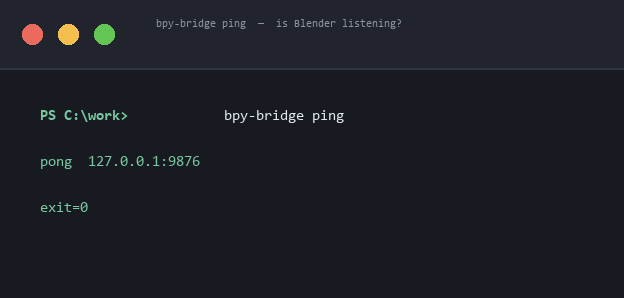
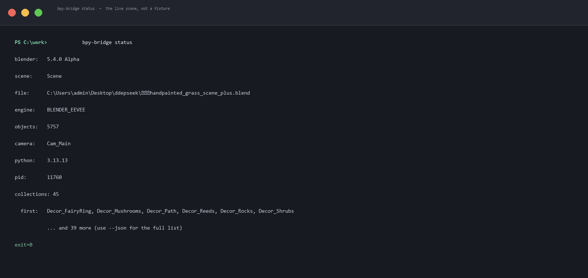
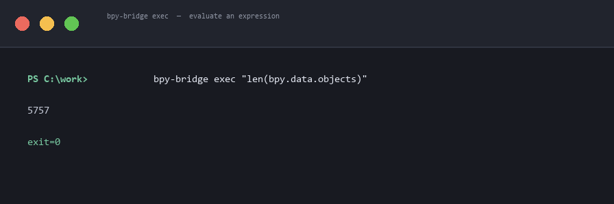
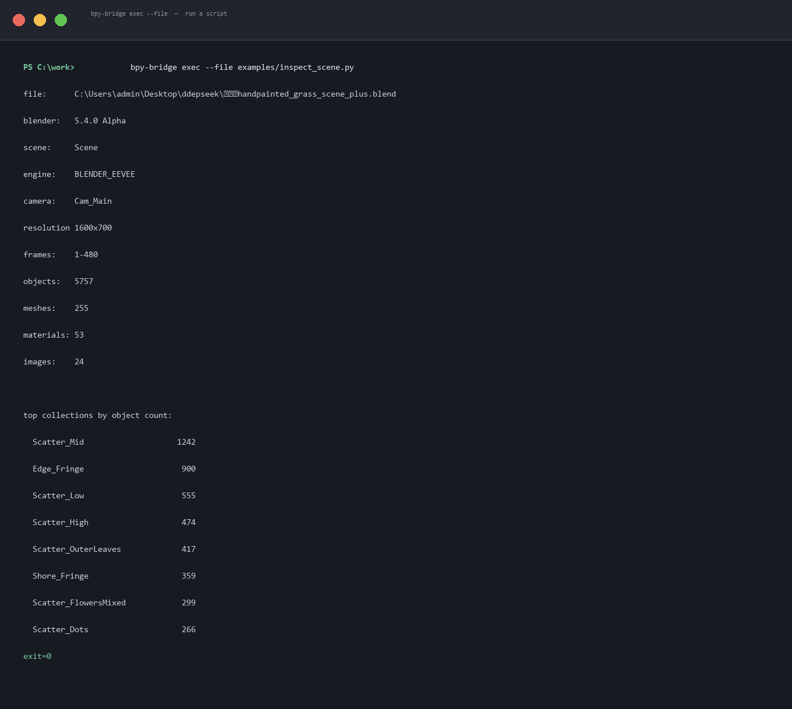
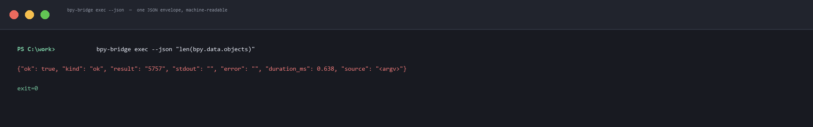
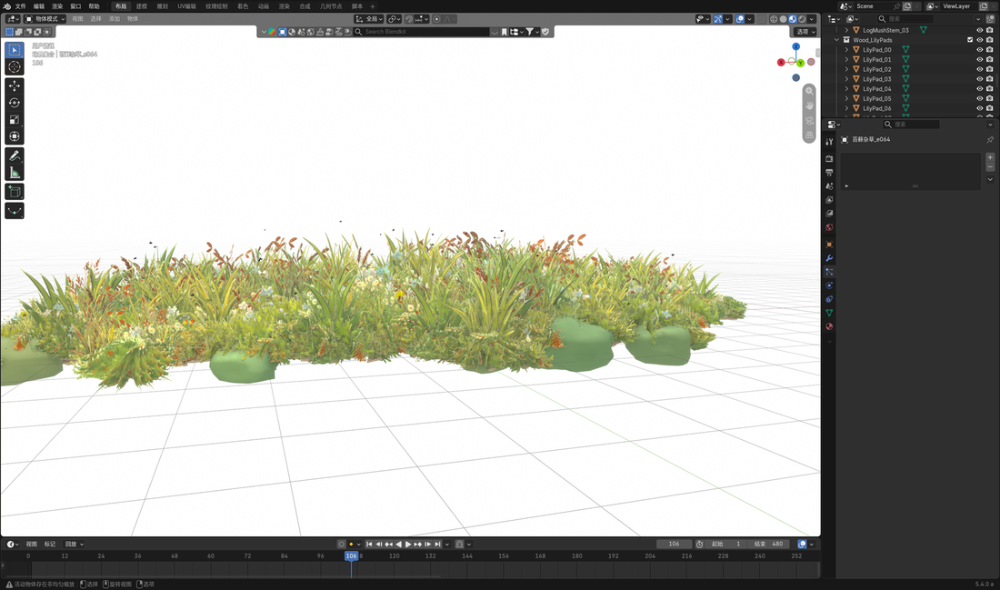
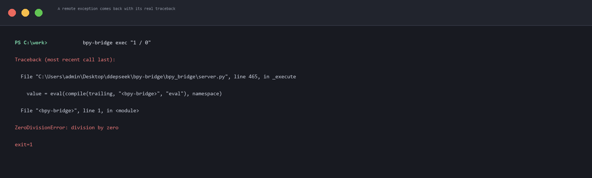
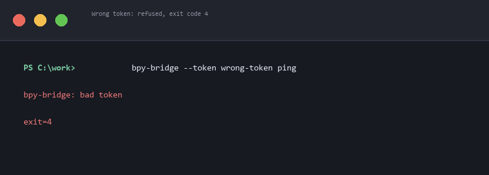
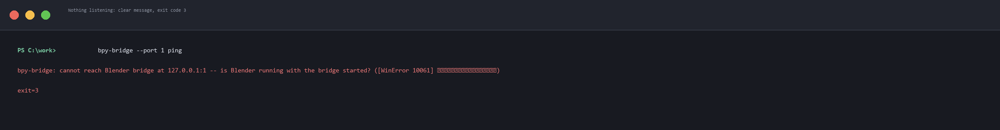

# Tutorial

**English** | [简体中文](tutorial.zh-CN.md)

A walkthrough from zero to a working loop, using a **real production scene** — not
a toy file. Every screenshot below was generated by running the actual command
against a live Blender session; see [Reproducing these screenshots](#reproducing-these-screenshots) at the end.

The scene used throughout is a hand-painted miniature landscape:

| | |
|---|---|
| File | `吉布提handpainted_grass_scene_plus.blend` |
| Blender | 5.4.0 Alpha (Python 3.13.13) |
| Objects | **5,757** |
| Collections | **45** |
| Meshes / materials / images | 255 / 53 / 24 |
| Camera | `Cam_Main`, 1600 × 700, frames 1–480 |

That scale matters: a bridge that works on a three-cube scene and falls over on
5,757 objects is not a bridge. This is the real thing.

---

## Before you start

You need:

1. **Blender 3.2 or newer**, running normally (a GUI session — you'll want it for
   the viewport screenshots).
2. **Python 3.8+** on the machine, with the CLI installed:

   ```bash
   pip install bpy-bridge
   ```

   Or, working from a checkout: `pip install -e ".[dev]"`.
3. A project directory you don't mind being the current directory — the examples
   reference `examples/`.

> **On Windows**, `bpy-bridge` is a console script. If your shell cannot find it
> after installing, use `python -m bpy_bridge.cli` instead; the arguments are
> identical.

---

## Step 1 — Start the bridge inside Blender

Open Blender. Press **`Shift+F4`** to turn the current area into a Python console.
Paste this, adjusting the path to wherever `server.py` actually lives:

```python
exec(compile(open(r"C:\path\to\bpy_bridge\server.py", encoding="utf-8").read(),
             "bpy_bridge_server", "exec"))
```

You should see two lines:

```
[bpy-bridge] listening on 127.0.0.1:9876 (protocol v1)
[bpy-bridge] token file: C:\Users\you\.bpy-bridge\token
```

What just happened:

- A TCP server bound to **loopback only** — nothing outside this machine can reach it.
- A **random 256-bit token** was generated and written to the token file.
- A `bpy.app.timers` callback was registered. This is the part that matters: it is
  what lets incoming code run on Blender's **main thread**, where `bpy` is safe.

Press `Shift+F5` to get your 3D viewport back. The bridge keeps running.

> **Tip.** To have the bridge start with every Blender launch, put the same
> `exec(...)` into a file under `scripts/startup/` in your Blender config
> directory. [docs/install.md](install.md) has the exact path per OS, plus an
> autostart file that fails safely.

---

## Step 2 — Confirm it answers

In a terminal:

```bash
bpy-bridge ping
```



`pong 127.0.0.1:9876` means three things at once: something is listening, the
token matches, and the main-thread pump is turning. If you see this, the rest of
the tutorial will work.

---

## Step 3 — Look at the live scene

```bash
bpy-bridge status
```



Read that output carefully, because it is the whole argument for this tool:

- **`objects: 5757`** — this is not a demo file.
- **`file:`** — the bridge reports the *actual* open document. No guessing whether
  you are looking at the scene you think you are.
- **`camera: Cam_Main`**, **`engine: BLENDER_EEVEE`**, **`resolution 1600x700`** —
  the settings a render script needs, without opening a single panel.
- **`collections: 45`** with a six-name preview. The full list is one flag away:

  ```bash
  bpy-bridge status --json
  ```

  which emits a single JSON object whose `status.collections` array holds all 45
  names. This is the difference between "nice output" and "something a script can
  use".

---

## Step 4 — Evaluate an expression

```bash
bpy-bridge exec "len(bpy.data.objects)"
```



`5757`. Note what you did **not** have to do: import anything, wrap the call in a
function, or restart Blender. `bpy` is available in the exec namespace because you
are inside Blender, where it is already loaded.

Expressions and statements both work, with Python REPL semantics — statements run,
and a trailing expression's value comes back:

```bash
bpy-bridge exec "import bpy; scene = bpy.context.scene; scene.name"
```

Variables persist across requests, because the exec namespace is shared for the
lifetime of the bridge:

```bash
bpy-bridge exec "tally = len(bpy.data.collections)"   # no output; assigns
bpy-bridge exec "tally"                                # 45
```

That persistence is what makes an iterative session feel like a REPL instead of a
series of cold starts.

---

## Step 5 — Run a script file

Real work lives in files, not one-liners. `examples/inspect_scene.py` prints a
summary of whatever scene is open:

```bash
bpy-bridge exec --file examples/inspect_scene.py
```



Everything printed inside Blender comes back as `stdout`, verbatim and in order.
The script is ordinary Python — it does `import bpy` and uses it like any Blender
script. There is no special API to learn.

The useful consequence: **this is how you iterate.** Edit the file, re-run the
command, look at the output. No relaunch, no re-opening the project, no losing
your undo history.

---

## Step 6 — Get machine-readable output

Human-readable output is for humans. When a shell script, a CI step, or an LLM
agent is the consumer, use `--json`:

```bash
bpy-bridge exec --json "len(bpy.data.objects)"
```



One JSON object on stdout, always the same shape:

```json
{"ok": true, "kind": "ok", "result": "5757", "stdout": "", "error": "", "duration_ms": 0.27, "source": "<argv>"}
```

The field that saves you trouble is **`kind`**: `ok`, `auth`, `timeout`, `exec`,
`protocol`, `internal`. Branch on `kind`, never on English error text. Combined
with the [documented exit codes](../README.md#exit-codes), a caller can tell
"Blender isn't running" from "the code raised" from "the token is wrong" without
parsing prose.

For structured data, the clean pattern is to **print** JSON and read it from
`stdout`:

```bash
bpy-bridge exec --file examples/collection_report.py --json
```

```python
# examples/collection_report.py (the important part)
print(json.dumps(report, sort_keys=True))
```

`result` holds the `repr` of the trailing expression, which is not parseable JSON
(`'{"a": 1}'` — note the outer quotes). `stdout` is exactly what the code printed.
Machine-consumable output belongs on stdout. This trips people up constantly, so
it is stated twice in the docs on purpose.

---

## Step 7 — Capture the viewport

This is the feature that changes how a session feels. Ask Blender to screenshot
itself:

```bash
bpy-bridge shot viewport.png
```

The bridge calls `bpy.ops.screen.screenshot()` on the main thread and returns the
absolute path. That gives you a real picture of the running session — viewport,
outliner, and all:



Why this matters more than it sounds:

- **You can see what the code did.** A procedural scatter that silently placed
  zero objects looks identical to a successful one in the logs, and completely
  different in a screenshot.
- **An agent can check its own work.** Generate → screenshot → inspect → adjust,
  without a human in the loop.
- **Bug reports get better.** "It looks wrong" becomes an image attached to the
  issue.

The same call is available from Python:

```python
from bpy_bridge import BridgeClient

bridge = BridgeClient()
bridge.screenshot("frames/step_07.png")
```

> **Requires a GUI session.** Headless Blender has no window to capture. Use
> `bpy.ops.render.render(write_still=True)` for headless renders instead.

---

## Step 8 — Close the loop: iterate without relaunching

Now the payoff. A seed sweep over a procedural scatter, with a screenshot per
iteration:

```python
from bpy_bridge import BridgeClient

bridge = BridgeClient()

for seed in range(40):
    bridge.exec_or_raise(f"import random; random.seed({seed}); bridge.exec_file('scatter.py')")
    bridge.screenshot(f"frames/seed_{seed:02d}.png")
    print("seed", seed, "->", bridge.exec("len(bpy.data.objects)").result)
```

Compare that to the alternative this replaces: relaunch Blender, re-open the
`.blend`, run the script, render, close — forty times. At roughly 30 seconds per
cycle that is twenty minutes of watching a progress bar; the loop above is
twenty minutes of *looking at results*.

`exec_or_raise` throws on the first failure, which is what you want in a batch:
one broken seed stops the sweep instead of leaving you 40 silently-wrong frames.

---

## When things go wrong

Three failures account for almost every question, and each has a distinct,
actionable shape.

### The code raised

```bash
bpy-bridge exec "1 / 0"
```



You get the **real traceback**, rendered inside Blender where the line numbers
refer to something, and exit code **1**. A partial `stdout` comes back too, so
whatever the code printed before dying is not lost.

### The token is wrong

```bash
bpy-bridge --token wrong-token ping
```



Exit code **4**. The request was refused before any code ran. This is the case
where you want to check `bpy-bridge token-path` against the `token file:` line
Blender printed at startup — a mismatch means the client and server are reading
different files (usually because they are different users).

### Nothing is listening

```bash
bpy-bridge --port 1 ping
```



Exit code **3**, and the message says what to check. The most common cause is
mundane: the bridge was never started in *this* Blender instance.

The full table lives in the [README](../README.md#exit-codes). The design rule
behind it: **exit codes are the contract**, and they never change meaning.

---

## What this looked like on the real project

The scene in every screenshot above was built with exactly this loop. Some
numbers from the session, for scale:

| Layer | Objects |
|---|---|
| `Scatter_Mid` | 1,242 |
| `Edge_Fringe` | 900 |
| `Scatter_Low` | 555 |
| `Scatter_High` | 474 |
| `Scatter_OuterLeaves` | 417 |
| `Shore_Fringe` | 359 |
| `Scatter_FlowersMixed` | 299 |
| `Scatter_Dots` | 266 |
| …38 more collections | 1,245 |
| **Total** | **5,757** |

The workflow was: run a script that adjusts a layer, screenshot the viewport,
look at it, adjust, repeat — without ever closing Blender or losing the undo
stack. Tuning 5,757 objects across 45 collections through a relaunch cycle is not
a workflow; it is a punishment.

> **A note on honesty.** The two bugs this tutorial's screenshots helped find —
> `bpy` missing from the exec namespace, and `None` coming back as the string
> `"None"` — were real, and were found by running the real commands above against
> this real scene. The screenshots are generated from the commands, so they cannot
> drift from the truth. See the CHANGELOG for both fixes.

---

## Reproducing these screenshots

The images in this document are **build artifacts**, not hand-made pictures:

```bash
# with Blender running and the bridge started
pip install pillow
python tools/render_terminal.py       # all 8 terminal screenshots
python tools/render_architecture.py   # the diagram
python tools/render_demo_gif.py       # the orbiting-camera GIF
```

`tools/screenshots.json` lists the commands to run; `tools/render_terminal.py`
runs them for real, captures stdout/stderr/exit code, and draws the result. If the
CLI changes, re-running the script updates the images. Nothing is transcribed by
hand, which is the only way documentation stays true.

To regenerate just one:

```bash
python tools/render_terminal.py --only terminal-status
```

`tools/render_demo_gif.py` works the same way: it orbits `Cam_Main` through eight
azimuths, one real `exec` per frame, rendering the actual scene camera each time.
It records the camera transform, collection visibility, and render settings first,
and restores all of them afterwards — and then *verifies* the restore, because a
documentation tool that leaves your project modified is a bug.

> **Why an orbit and not a layer toggle.** The first version of the GIF hid
> scatter layers one at a time. Measured against this scene, hiding
> `Scatter_Low` (555 objects), `Scatter_OuterLeaves` (417) and `Shore_Fringe`
> (359) produced a pixel difference of exactly **0.00** — the geometry is
> genuinely occluded by taller layers. A demo whose frames look identical is not
> a demo, so the measurement chose the demo, not the other way round.

---

## Where to go next

- **[Configuration](configuration.md)** — ports, tokens, timeouts, autostart, and
  every knob the server and client expose.
- **[Protocol](protocol.md)** — the wire format, precise enough to write a client
  in another language.
- **[Security](security.md)** — what the defaults protect against, and what they
  deliberately do not.
- **[Installing it permanently](install.md)** — autostart, so the bridge is there
  every time Blender launches.
