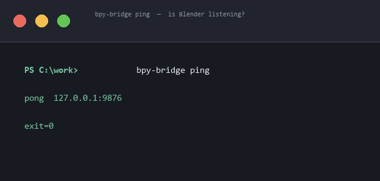
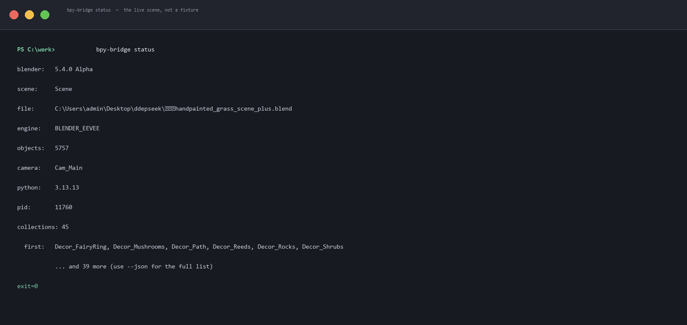
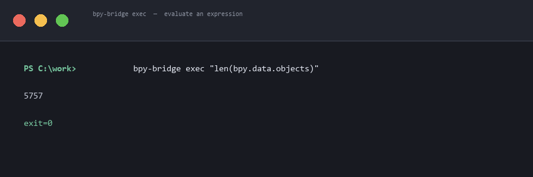
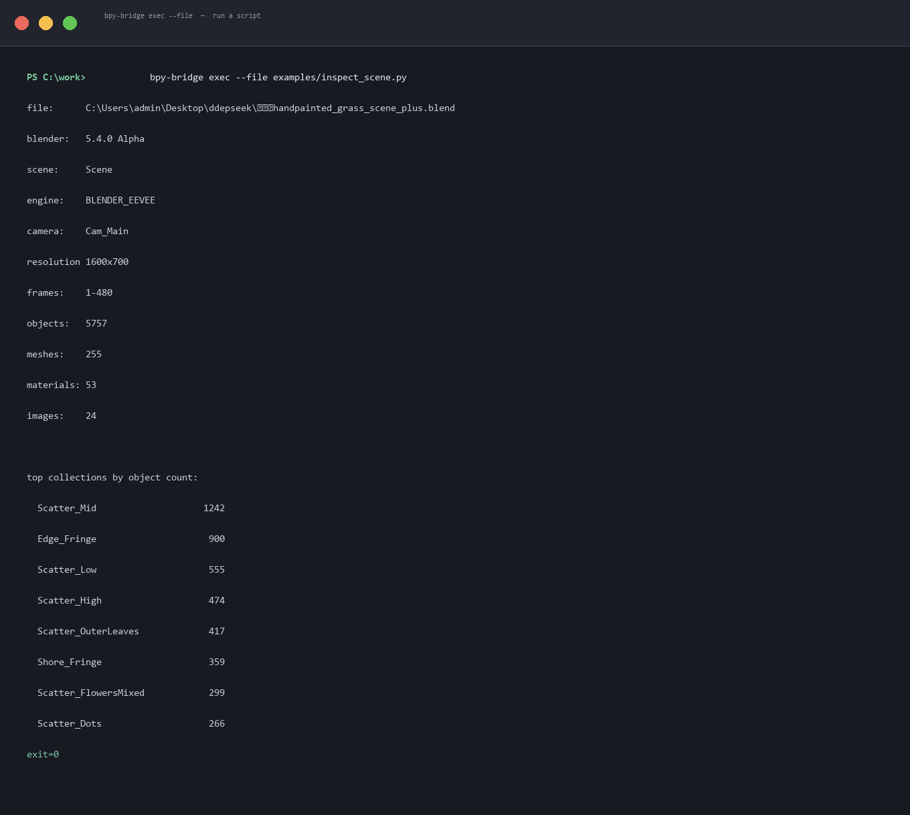
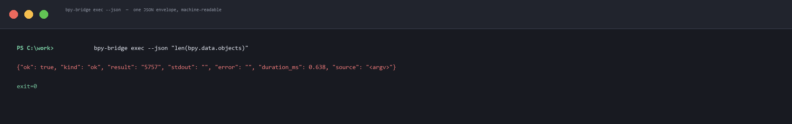
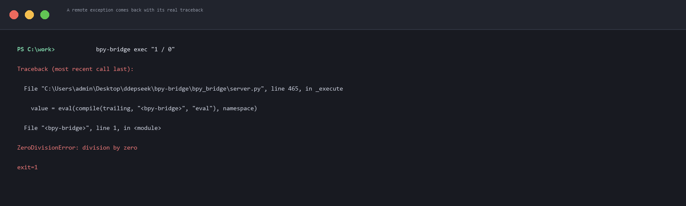
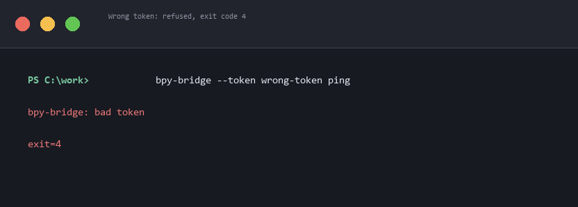
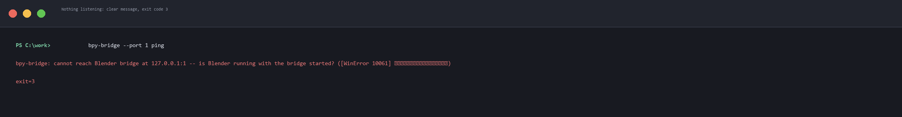

# 教程

[English](tutorial.md) | **简体中文**

从零走到一个能跑通的迭代循环，全程使用一个**真实的生产场景**，而不是玩具文件。下面每一张截图，都是对着正在运行的 Blender 会话执行真实命令生成的；生成方式见文末 [如何复现这些截图](#如何复现这些截图)。

本文贯串始终的场景是一个手绘微缩景观：

| | |
|---|---|
| 文件 | `吉布提handpainted_grass_scene_plus.blend` |
| Blender | 5.4.0 Alpha（Python 3.13.13） |
| 对象数 | **5,757** |
| 集合数 | **45** |
| 网格 / 材质 / 贴图 | 255 / 53 / 24 |
| 相机 | `Cam_Main`，1600 × 700，1–480 帧 |

这个规模是有意义的：一个在三个立方体上能跑、在 5,757 个对象上就趴下的桥接服务，不叫桥接服务。这里是真家伙。

---

## 开始之前

你需要：

1. **Blender 3.2 或更新版本**，以正常方式运行（带 GUI —— 视口截图需要它）。
2. 机器上有 **Python 3.8+**，并装好 CLI：

   ```bash
   pip install bpy-bridge
   ```

   如果是从代码仓库直接用：`pip install -e ".[dev]"`。
3. 一个你可以当工作目录的项目目录 —— 示例里引用了 `examples/`。

> **Windows 上**：`bpy-bridge` 是一个控制台脚本。如果装完之后 shell 找不到它，
> 改用 `python -m bpy_bridge.cli`，参数完全一样。

---

## 第 1 步 —— 在 Blender 里启动桥接

打开 Blender。按 **`Shift+F4`**，把当前区域切换成 Python 控制台。把下面这段粘进去，把路径改成 `server.py` 的实际位置：

```python
exec(compile(open(r"C:\path\to\bpy_bridge\server.py", encoding="utf-8").read(),
             "bpy_bridge_server", "exec"))
```

你应该看到两行输出：

```
[bpy-bridge] listening on 127.0.0.1:9876 (protocol v1)
[bpy-bridge] token file: C:\Users\you\.bpy-bridge\token
```

刚刚发生了什么：

- 一个 TCP 服务绑到了**仅回环地址** —— 本机之外的任何东西都够不到它。
- 生成了一个**随机 256 位 token**，写进了 token 文件。
- 注册了一个 `bpy.app.timers` 回调。**这才是关键的一步**：它让进来的代码跑在 Blender 的**主线程**上，而 `bpy` 只有在那儿才是安全的。

按 `Shift+F5` 回到 3D 视口。桥接服务继续运行。

> **小技巧**：想让每次启动 Blender 都自动带上桥接，把同样的 `exec(...)` 放进
> Blender 配置目录下 `scripts/startup/` 里的一个文件即可。各操作系统的确切路径、
> 以及一个「出错也不会拖垮启动」的自启文件，都在 [docs/install.md](install.md)。

---

## 第 2 步 —— 确认它能应答

在一个终端里：

```bash
bpy-bridge ping
```



`pong 127.0.0.1:9876` 一次说明三件事：有东西在监听、token 对得上、主线程泵在转。看到这个，后面整篇教程就都能跑。

---

## 第 3 步 —— 看一眼活着的场景

```bash
bpy-bridge status
```



仔细读这段输出，因为它就是这个工具存在的全部理由：

- **`objects: 5757`** —— 这不是演示文件。
- **`file:`** —— 桥接报告的是**真正**打开着的文档。不用猜你现在看的是不是你以为的那个场景。
- **`camera: Cam_Main`**、**`engine: BLENDER_EEVEE`**、**`resolution 1600x700`** —— 渲染脚本需要的设置，一个面板都不用打开。
- **`collections: 45`**，附带六个名字的预览。完整列表只差一个参数：

  ```bash
  bpy-bridge status --json
  ```

  它会输出一个 JSON 对象，其中 `status.collections` 数组包含全部 45 个名字。这就是「输出好看」和「脚本能用」的区别。

---

## 第 4 步 —— 求值一个表达式

```bash
bpy-bridge exec "len(bpy.data.objects)"
```



`5757`。注意你**没有**做的事：没有 import 任何东西，没有把调用包进函数，也没有重启 Blender。`bpy` 之所以在执行命名空间里可用，是因为你就在 Blender 里，它本来就已经加载好了。

表达式和语句都能用，语义与 Python REPL 一致 —— 语句会执行，末尾表达式的值会返回：

```bash
bpy-bridge exec "import bpy; scene = bpy.context.scene; scene.name"
```

变量能跨请求持久化，因为执行命名空间在桥接的整个生命周期里是共享的：

```bash
bpy-bridge exec "tally = len(bpy.data.collections)"   # 无输出；只是赋值
bpy-bridge exec "tally"                                # 45
```

正是这种持久化，让一次迭代会话感觉像 REPL，而不是一连串冷启动。

---

## 第 5 步 —— 运行一个脚本文件

真正的活儿写在文件里，不是单行命令。`examples/inspect_scene.py` 会打印当前打开场景的摘要：

```bash
bpy-bridge exec --file examples/inspect_scene.py
```



在 Blender 里打印的一切，都会原样、按顺序作为 `stdout` 回来。这个脚本就是普通的 Python —— 它 `import bpy`，然后像任何 Blender 脚本一样使用。没有任何新 API 要学。

由此得到一个很实用的结论：**这就是你迭代的方式。** 改文件，重跑命令，看输出。不用重启，不用重新打开工程，也不会丢掉撤销历史。

---

## 第 6 步 —— 拿到机器可读的输出

给人看的输出是给人看的。当消费者是 shell 脚本、CI 步骤或者 LLM agent 时，用 `--json`：

```bash
bpy-bridge exec --json "len(bpy.data.objects)"
```



stdout 上只有一个 JSON 对象，形状永远一致：

```json
{"ok": true, "kind": "ok", "result": "5757", "stdout": "", "error": "", "duration_ms": 0.27, "source": "<argv>"}
```

最省事的字段是 **`kind`**：`ok`、`auth`、`timeout`、`exec`、`protocol`、`internal`。**按 `kind` 分支，永远不要按英文错误文本分支。** 配合[有文档的退出码](../README.zh-CN.md#退出码)，调用方不用解析散文，就能区分「Blender 没在跑」「代码抛异常了」「token 不对」。

要拿结构化数据，干净的做法是 **print** 出 JSON，然后从 `stdout` 读：

```bash
bpy-bridge exec --file examples/collection_report.py --json
```

```python
# examples/collection_report.py（关键的那一行）
print(json.dumps(report, sort_keys=True))
```

`result` 里放的是末尾表达式的 `repr`，它不是可解析的 JSON（`'{"a": 1}'` —— 注意外面那层引号）。`stdout` 才是代码真正打印的东西。**给机器消费的输出，就该走 stdout。** 这一点坑了无数人，所以文档里故意说了两遍。

---

## 第 7 步 —— 截取视口

这个功能会改变一次会话的手感。让 Blender 给自己截图：

```bash
bpy-bridge shot viewport.png
```

桥接会在主线程上调用 `bpy.ops.screen.screenshot()`，并返回绝对路径。这样你就拿到了一张运行中会话的真实照片 —— 视口、大纲视图，全都在：


为什么这件事比听起来重要：

- **你能看见代码干了什么。** 一个悄悄放了零个对象的程序化散布，在日志里和一个成功的散布长得一模一样，在截图里则完全不同。
- **agent 能检查自己的工作。** 生成 → 截图 → 检查 → 调整，不需要人在环路里。
- **bug 报告质量会变好。** 「它看起来不对」变成一张贴进 issue 的图。

同样的调用在 Python 里也有：

```python
from bpy_bridge import BridgeClient

bridge = BridgeClient()
bridge.screenshot("frames/step_07.png")
```

> **需要 GUI 会话。** 无头 Blender 没有窗口可抓。无头渲染请改用
> `bpy.ops.render.render(write_still=True)`。

---

## 第 8 步 —— 闭环：不重启地迭代

现在是回报的时刻。对程序化散布做一次种子扫描，每次迭代配一张截图：

```python
from bpy_bridge import BridgeClient

bridge = BridgeClient()

for seed in range(40):
    bridge.exec_or_raise(f"import random; random.seed({seed}); bridge.exec_file('scatter.py')")
    bridge.screenshot(f"frames/seed_{seed:02d}.png")
    print("seed", seed, "->", bridge.exec("len(bpy.data.objects)").result)
```

对比一下它取代的那个做法：重启 Blender、重新打开 `.blend`、跑脚本、渲染、关闭 —— 四十遍。按每轮约 30 秒算，那是二十分钟盯着进度条；而上面这个循环，是二十分钟**看结果**。

`exec_or_raise` 会在第一次失败时抛异常，这在批处理里正是你要的：一个坏种子会终止扫描，而不是给你留下 40 张悄悄出错、没人发现的帧。

---

## 出问题的时候

几乎所有问题都落在这三种失败上，每一种都有独立、可操作的形态。

### 代码抛了异常

```bash
bpy-bridge exec "1 / 0"
```



你拿到的是**真实 traceback**，它在 Blender 内部渲染，那里的行号才指向真实的东西；退出码是 **1**。部分 `stdout` 也会一起回来，所以代码在死之前打印的内容不会丢。

### token 不对

```bash
bpy-bridge --token wrong-token ping
```



退出码 **4**。请求在任何代码执行之前就被拒了。这种时候你要做的是把 `bpy-bridge token-path` 的输出和 Blender 启动时打印的 `token file:` 那一行对一下 —— 对不上通常意味着客户端和服务端读的是不同文件（最常见的原因是它们属于不同用户）。

### 没有东西在监听

```bash
bpy-bridge --port 1 ping
```



退出码 **3**，并且提示信息会告诉你去查什么。最常见的原因很平常：桥接根本没在**这个** Blender 实例里启动过。

完整表格在 [README](../README.zh-CN.md#退出码)。背后的设计原则：**退出码就是契约**，它们的含义永不改变。

---

## 在真实项目上是什么样子

上面每张截图里的场景，都是用这个循环做出来的。下面是那次会话里的一些数字，用来感受规模：

| 层 | 对象数 |
|---|---|
| `Scatter_Mid` | 1,242 |
| `Edge_Fringe` | 900 |
| `Scatter_Low` | 555 |
| `Scatter_High` | 474 |
| `Scatter_OuterLeaves` | 417 |
| `Shore_Fringe` | 359 |
| `Scatter_FlowersMixed` | 299 |
| `Scatter_Dots` | 266 |
| ……另外 38 个集合 | 1,245 |
| **合计** | **5,757** |

工作流就是：跑一个调整某层的脚本、截图视口、看、再调、再来一遍 —— 全程不关 Blender，也不丢撤销栈。靠重启循环去调 45 个集合里的 5,757 个对象，那不叫工作流，那叫惩罚。

> **一点实话。** 这篇教程的截图帮着找出的两个 bug —— 执行命名空间里缺 `bpy`，
> 以及 `None` 被当成字符串 `"None"` 返回 —— 都是真的，都是拿上面这些真实命令、
> 对着这个真实场景跑出来的。截图由命令生成，所以它们不会偏离事实。两个修复都记在
> CHANGELOG 里。

---

## 如何复现这些截图

本文档里的图片是**构建产物**，不是手工画的：

```bash
# 前提：Blender 正在运行，且桥接已启动
pip install pillow
python tools/render_terminal.py       # 全部 8 张终端截图
python tools/render_architecture.py   # 架构图
```

`tools/screenshots.json` 列出要跑哪些命令；`tools/render_terminal.py` 真去跑它们，捕获 stdout/stderr/退出码，再把结果画出来。CLI 变了，重跑脚本图片就更新。没有任何东西是手工誊写的 —— 这是文档保持真实的唯一办法。

只重新生成一张：

```bash
python tools/render_terminal.py --only terminal-status
```

---

## 接下来读什么

- **[配置说明](configuration.zh-CN.md)** —— 端口、token、超时、自启动，以及服务端和客户端暴露的每一个旋钮。
- **[协议](protocol.md)** —— 线格式，精确到你可以用另一种语言写客户端。（目前仅英文）
- **[安全](security.md)** —— 默认值防住了什么，又故意不防什么。（目前仅英文）
